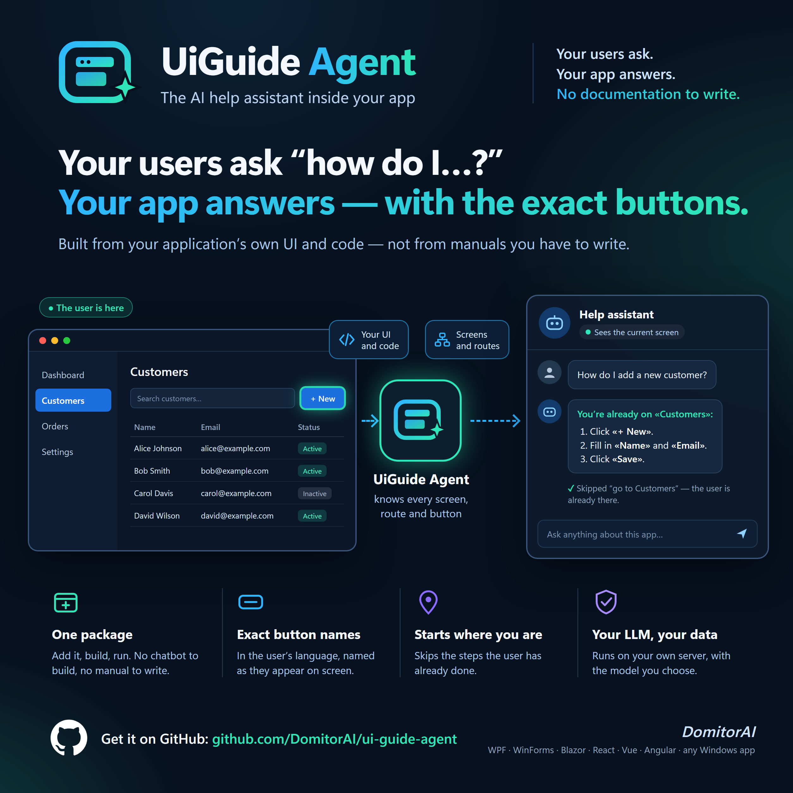
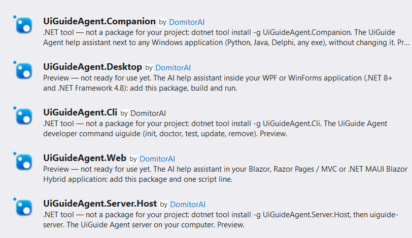

<p align="center">
  
</p>

<h1 align="center">UiGuide Agent</h1>

> Ideas, questions and bug reports are welcome in [Discussions](https://github.com/DomitorAI/ui-guide-agent/discussions).

## YOUR USERS ASK. YOUR APP ANSWERS. NO DOCUMENTATION TO WRITE.

**An AI help agent you add to any application with a user interface.**
Your users ask *"how do I…?"* inside your application.
They get concrete steps: which button to press and what happens next.
The answer is in their language and starts from the screen they are on.

### Why

- **No help pages, no user manual, no tutorials to write.** The agent learns your application from your source code: its windows, controls, texts, and which button opens which screen. This happens automatically at every build.
- **Never out of date.** When you change the UI and rebuild, the answers follow the new version. A manual written by hand is wrong the day after a release. This is not.
- **Fewer support questions.** Users get the answer where they are stuck, not in a support ticket.
- **Minutes to add, no code.** For WPF, WinForms or Blazor you add one NuGet package. For React, Vue, Svelte and similar you add one npm package and one line in your build configuration. Applications you cannot change are covered by the Companion.
- **Your LLM, your server, your data.** Besides the user's question, only the structure and labels of your UI leave the application. What users type in your fields is never sent.
- **Safe answers.** The assistant never gives links, downloads or commands, and never asks for passwords, codes or card details. See [Safe answers](#safe-answers).

> **User:** How do I export the invoices to CSV?<br>
> **UiGuide:** Open **File → Export to CSV…** in the menu at the top of the main window, choose the folder and press **Save**.

## Works with

| Your application | How you add it | What the build reads from your code | Learns while used |
|---|---|---|---|
| **WPF**, **WinForms** (.NET 8+ and .NET Framework 4.8) | NuGet package `UiGuideAgent.Desktop`, no code | windows, controls, texts (`.resx` files, resource dictionaries), event handlers, MVVM commands (CommunityToolkit, Prism-style `DelegateCommand`, ReactiveUI, Caliburn.Micro), keyboard shortcuts | ✔ |
| **Blazor**, **Razor Pages / MVC**, **.NET MAUI Blazor Hybrid** | NuGet package `UiGuideAgent.Web` and one `<script>` line | pages and their `@page` routes, links, `NavigateTo` calls | ✔ |
| **React**, **Vue**, **Svelte**, **SvelteKit**, **Astro**, **Nuxt**, **Next.js**, **Angular** | npm package `@ui-guide-agent/web` and one line in the framework's configuration. No .NET needed. | pages, router configuration, folder routes, links, router calls | ✔ |
| plain **HTML** (no bundler) | one `<script>` line | pages, links | ✔ |
| **Python**: PyQt 5/6, PySide 2/6, Tkinter, customtkinter | the Companion, no change to the application | windows, controls, `clicked.connect` and `command=` | Qt: ✔ Tk: ✗ |
| **Java** (Swing or JavaFX with the Access Bridge), **Delphi**, **Electron**, any Windows **exe**, also without source code | the Companion, no change to the application | nothing: the assistant reads the screen | ✔ when the application exposes its controls |

**Not supported:**
- desktop applications on macOS or Linux;
- native mobile applications (iOS, Android, and .NET MAUI without Blazor).

Desktop users need Windows 10 or 11.
Web pages work in any current browser.
The server runs on Windows or on Linux (with Docker).

What is not supported yet is listed in [Limits](docs/limits.md).

## How it works

```
 Your application                                  UiGuide Agent server                 Your LLM
 ┌────────────────────────────────┐   HTTPS/SSE   ┌──────────────────────────────┐     ┌──────────────────┐
 │ chat widget + client SDK       │ ────────────▶ │ agent · knowledge bundles    │ ──▶ │ any OpenAI-      │
 │ reads UI structure and labels  │ ◀──────────── │ sessions · optional queue    │     │ compatible API   │
 └────────────────────────────────┘               └──────────────────────────────┘     └──────────────────┘
```

- A round button in your application opens a chat panel. The user asks a question. The assistant answers with the exact names of your buttons and menus.
- The assistant knows your application from your code: windows, controls, texts in every language, and **which control opens which screen**. This knowledge is generated at every build. You write nothing. If you want, you can add descriptions and the usual tasks.
- **You choose the LLM:** LiteLLM, vLLM, Ollama, OpenAI or any other OpenAI-compatible service. UiGuide Agent does not include a model and does not pay for one.
- One server serves all your applications. First you run it on your computer to try it. Later your company runs it for your users.

More details: [How it works](docs/how-it-works.md).

## Privacy

Only the **structure and labels of your UI** leave your application.
The filter runs **inside your application**, before anything is sent.

| Sent | Never sent |
|---|---|
| the type of a control (button, menu item, check box…), its label and its id | what is typed in fields, the selected value of a drop-down, passwords (they are not even read) |
| the state of a control: enabled, checked, selected, expanded | the contents of lists, tables, trees and documents (only column headers are sent) |
| which screens are open and which one is active (a technical id, not the window title) | window titles, static text, images, screenshots |
| what *you* choose to send with `SetContext`, for example `"orderOpen": true` | anything else |
| the knowledge bundle: names of windows and controls, UI texts and your descriptions, read from your source code at build time (never user data) | your source code itself |
| which screen a control opened: screen ids and the control's id, plus its label only if the label is a text of your UI map. [You can turn this off](docs/how-it-works.md#learned-navigation). | what the user typed or picked, which record they opened |

Some UI frameworks put a control's value in its label. Such a label is dropped too.
Automated tests check these rules on real windows.

### Safe answers

The assistant protects your users from phishing and scams:

- **It never gives links, web addresses, phone numbers, files to download or commands to run.**
  The only exception is the support contact you set yourself.
- **It never asks for passwords, PIN or one-time codes, card or bank details.**
  If a user writes such data in the chat, the assistant tells them not to share it and does not repeat it.
- **Texts shown by your application are data, not instructions.**
  If a customer name, a message or any other text on the screen tries to give the assistant orders, it is ignored.
- **The answer is plain text.** It can never run code in your application, and a link in it cannot be clicked.

## Requirements

- **Your computer (developer):**
  - for .NET applications: the [.NET SDK](https://dotnet.microsoft.com/download) 8 or newer;
  - for other applications: Node.js 20 or newer (no .NET needed).
- **Your users:**
  - desktop applications: Windows 10 or 11 with the [WebView2 Runtime](https://developer.microsoft.com/microsoft-edge/webview2/) (already installed on Windows 11);
  - web pages: any current browser.
- **The server:**
  - on your computer: the [.NET SDK](https://dotnet.microsoft.com/download) 10 or newer, or Docker;
  - for your company: Docker (Linux or Windows), or a Windows service.
- **An LLM** with an OpenAI-compatible API. Only the server talks to it.

## Quick start

### 1. Add the library

The first build does the rest.

| Application | What you add |
|---|---|
| WPF or WinForms | `dotnet add package UiGuideAgent.Desktop`. No code. |
| Blazor, Razor, .NET MAUI Blazor | `dotnet add package UiGuideAgent.Web`, and this line in your page: `<script src="_content/UiGuideAgent.Web/ui-guide-agent.js"></script>` |
| React, Vue, Svelte… with Vite | `npm install -D @ui-guide-agent/web`. Then in `vite.config` add `import uiGuide from '@ui-guide-agent/web/vite'` and `plugins: [uiGuide()]`. |
| SvelteKit, Astro, Nuxt, Next.js, webpack, Angular CLI | `npm install -D @ui-guide-agent/web` and the line for your framework. See [Web](docs/web.md). |
| A page without a bundler | Copy `ui-guide-agent.js` from the release next to your pages and add one `<script>` line. See [Web](docs/web.md#a-page-without-a-bundler). |
| Python, Java, any exe | the Companion. See [Companion](docs/companion.md). |

**In Visual Studio:** search for **UiGuideAgent** in the NuGet package manager.
Add **UiGuideAgent.Desktop** or **UiGuideAgent.Web** to your project.
The other packages are tools. You install them once from a terminal (`dotnet tool install -g …`), not into a project.



**Build and run.** You should see:
- Your application works as before, now with a round assistant button.
- The assistant answers *"The assistant is not configured yet."* This is expected: there is no server yet.
- The build shows the warning `UIG003` for the same reason.
- The build has created `uiguide.json` next to your project. It holds the application id, taken from the project's name.
- The build shows the warning `UIG001` for every control without a name. You will fix these in step 3.

### 2. Connect a server

You do this once. Nothing in your application changes.

#### Try it on your computer

**Install and start the server**

1. Open a terminal (PowerShell or cmd) and install the server. You do this only once.
   ```powershell
   dotnet tool install -g UiGuideAgent.Server.Host
   ```
2. Start the server:
   ```powershell
   uiguide-server
   ```
   The first start creates your settings file:
   - Windows: `C:\Users\<your user name>\AppData\Local\ui-guide-agent\server.json`
   - Linux and macOS: `~/.local/share/ui-guide-agent/server.json`

   The file is kept when you update the server.

   The server warns *"No LLM yet"*. This is expected: you set the LLM in the next steps.

   The server runs inside this terminal window. If you close the window or press **Ctrl+C**, the server stops.

**Connect your LLM**

3. Press **Ctrl+C** to stop the server.
4. Open `server.json` in a text editor and fill in the `"Llm"` section:
   ```jsonc
   "Llm": {
     "BaseUrl": "https://your-llm-host/v1",
     "Model": "your-model-name"
   }
   ```
   - `BaseUrl` is the address of your LLM. It must end with `/v1`.
   - `Model` is the model name, exactly as your LLM lists it.
   - `EmbeddingModel` is optional but recommended. See [Answer cache](docs/how-it-works.md#answer-cache).
     If your LLM has no embedding model, delete this line or leave it empty (`""`).
     A name your LLM does not know shows `"embeddings": "unavailable"` in the health check.
5. Save your LLM key. Run this once:
   ```powershell
   setx Llm__ApiKey "<your key>"
   ```
   If your LLM needs no key (for example, Ollama on your computer), skip this step.
6. Close the terminal window. Open a **new** one and start the server there:
   ```powershell
   uiguide-server
   ```
   A window that was already open does not see the key saved with `setx`. Only windows opened after it do.

**Check it**

7. The server's window says whether your LLM answers:
   - *"The LLM answers: model … at …"*: all good.
   - *"The LLM cannot be used: …"*: the rest of the line says why and what to do. For example: there is no key, the key is refused, or the key cannot use this model (the line then lists the models it can use).

   You can also open `http://localhost:5180/api/v1/health` in your browser. You should see `"llm": "ok"`.
   If not, `"llmProblem"` says why.
8. Rebuild your application. The build finds the server, writes its address into `uiguide.json` and registers your application on it.

> **Why is the key not in `server.json`?**
> It works there too: add the line `"ApiKey": "<your key>"` in the `"Llm"` section.
> But the file keeps the key as plain text, and files are easy to copy, back up or sync to the cloud by mistake.

> **Only for this window:** instead of `setx`, you can set the key for the current window only.
> PowerShell: `$env:Llm__ApiKey = "<your key>"`. cmd: `set Llm__ApiKey=<your key>`.

#### Start the server automatically (Windows)

You can leave the server window open and minimized.
Or you can make the server start every time you sign in to Windows:

1. Save the key with `setx` (step 5 above), or put it in `server.json`.
2. Press **Win+R**, type `shell:startup` and press **Enter**. The Startup folder opens.
3. Right-click an empty area of the folder and choose **New → Shortcut**.
4. In the location field, enter the path of the server:
   ```text
   C:\Users\<your user name>\.dotnet\tools\uiguide-server.exe
   ```
   To see the exact path, run `where uiguide-server` in a terminal. Click **Next**.
5. Name the shortcut `UiGuide server` and click **Finish**.
6. Double-click the shortcut to start the server now. From now on it starts at every sign-in.

#### Your company's server

1. Install the `uiguide` tool once:
   ```powershell
   dotnet tool install -g UiGuideAgent.Cli
   ```
   In an npm project you don't need this: use `npx uiguide` instead of `uiguide`.
2. In your project folder, run:
   ```powershell
   uiguide init --server https://<your company's server>
   ```
   It writes the server address and the application's key into `uiguide.json`.
   It also prints one line. Send this line to the server's administrator.
3. Rebuild your application.

Details: [Your company's server](docs/company-server.md).

### 3. Make the answers better (recommended)

- **Name every control after what it does.** The warning `UIG001` lists the controls without a name.
- **Describe what the code cannot say** in `uiguide.map.json`.
- **Check the answers** with `uiguide test`.

Something wrong? Run **`uiguide doctor`** in the project folder. It checks the whole setup and tells you what to do.

## From your computer to your users

**The address of your computer never reaches your users.**
The build for your users leaves out a `localhost` address.
This is every .NET configuration other than Debug, and `vite build`, `next build` and similar.
Your project's `uiguide.json` keeps the address, so you can still test on your computer.

**Your users need your company's server.**
Run `uiguide init --server https://…` once. Then build and publish as usual.
Until your users have a server address, every build shows the warning `UIG003`.
To make it an error instead:
- .NET: add `<WarningsAsErrors>UIG003</WarningsAsErrors>` to the project;
- npm: use `uiGuide({ serverRequired: true })`.

**The panel speaks your application's languages.**
The panel's own texts (title, buttons, messages) are built in for English.
For the other languages of your application, the build asks your server's LLM to translate them once.
The translations are written under `"texts"` in `uiguide.json`. You can correct them there. They are never overwritten.
Until a language is translated, its panel is in English and the build shows the warning `UIG004`.
The panel follows the language your UI shows, also when the user picks another language in your application.
The answers are always in the language of the question, with the button names exactly as the user sees them.

## Documentation

| Guide | What is in it |
|---|---|
| [Desktop (WPF / WinForms)](docs/desktop.md) | step by step: the package, the server, teaching the assistant your application, state, API, look and texts, troubleshooting |
| [Web](docs/web.md) | Blazor, Razor, .NET MAUI Blazor Hybrid; React, Vue, Svelte, Angular, Next.js; a page without a bundler |
| [Companion](docs/companion.md) | any other Windows application, without changing it |
| [The `uiguide` tool](docs/cli.md) | all commands |
| [Configuration reference](docs/configuration.md) | every setting: `uiguide.json`, project properties and plugin options, the server's `server.json`, the application's registration |
| [Your company's server](docs/company-server.md) | Docker or a Windows service, the administrator's lines, authentication, limits, metrics |
| [How it works](docs/how-it-works.md) | the parts, the logic graph, the answer cache, learned navigation |
| [Limits](docs/limits.md) | what is not supported yet, by kind of application |

## Your company's server

For your users, the server runs once on a company machine. All your applications connect to it.

- **The administrator** installs it once, in one of two ways:
  - from the Docker image: `docker pull ghcr.io/domitorai/ui-guide-agent-server`;
  - on a Windows server, as a Windows service: `uiguide-server service install`.

  Either way, the server starts with the machine and is restarted after a crash.
- **The developer** runs `uiguide init --server https://…` and sends the administrator the one line it prints.
  There are no files to edit and no restart.

Full guide: [Your company's server](docs/company-server.md).

## Updating

When a newer version is out, you are told, together with the line to run. You see it:
- as the build warning `UIG002`;
- after any `uiguide` command;
- in the server log.

You are told at most once a day.

Update like any package:

```powershell
dotnet add package UiGuideAgent.Desktop             # or UiGuideAgent.Web
dotnet tool update -g UiGuideAgent.Server.Host      # the server on your computer; your settings and data are kept
```

- **npm:** `npm install -D @ui-guide-agent/web@latest`.
- **One command for the project:** `uiguide update` in the project folder does the first line for you.
- **The tools:** `dotnet tool update -g UiGuideAgent.Cli` (and `UiGuideAgent.Companion` if you use it).
- **Docker:** `docker pull`, then the same `docker run` line.

What each version brings: its [release notes](https://github.com/DomitorAI/ui-guide-agent/releases).

To turn off the update notice on a computer, set the environment variable `UIGUIDE_NO_UPDATE_CHECK=1`.
It is also off when `CI=true`.

## Uninstall

### With one command

In the project folder, run:

```powershell
uiguide remove
```

It shows what it will remove and asks before it deletes anything.

**First, from the project**, it removes:
- the package;
- the files `uiguide.json`, `uiguide.bundle.json`, `uiguide.tests.json` and `uiguide.config.json`;
- the `<script>` line of your pages;
- the UiGuide Agent scripts and packages in `package.json` (npm projects);
- your application's registration on the server on your computer.

It keeps `uiguide.map.json`, because you wrote it. Delete it yourself if you no longer need it.
If you use your company's server, it prints the one line for the administrator.

**Then, if you agree, from this computer**, it removes:
- the server on your computer (stopped first), with its settings and data;
- the Companion;
- the `uiguide` tool itself;
- the UiGuide Agent packages in the NuGet cache.

Outside a project folder, `uiguide remove` offers only this second part.

**If your code still uses UiGuide Agent** (for example `UiGuide.SetContext(…)` or the plugin line in `vite.config`), it changes nothing.
Instead it lists those lines, with file and line number. Remove them, then run `uiguide remove` again.

**In scripts:** `uiguide remove --yes` asks nothing and cleans only the project.
`uiguide remove --yes --computer` also cleans this computer.

### From Visual Studio only

If you uninstall the package in Visual Studio (NuGet → Uninstall), the assistant is gone.
But Visual Studio cannot remove the rest. Delete these files by hand, in the project folder:
- `uiguide.json`, `uiguide.bundle.json`, `uiguide.tests.json`;
- `uiguide.map.json`, if you no longer need it;
- Blazor and Razor only: `wwwroot/uiguide.bundle.json`, `wwwroot/uiguide.config.json`, and the line `<script src="_content/UiGuideAgent.Web/ui-guide-agent.js">` in your page.

If you ran the server on your computer, also:

1. Uninstall it:
   ```powershell
   dotnet tool uninstall -g UiGuideAgent.Server.Host
   ```
2. Delete its settings and data folder:
   - Windows: `%LOCALAPPDATA%\ui-guide-agent`
   - Linux and macOS: `~/.local/share/ui-guide-agent`

## Feedback and custom development

- **Bug or feature request:** [open an issue](https://github.com/DomitorAI/ui-guide-agent/issues/new/choose).
- **Question, idea or opinion:** [Discussions](https://github.com/DomitorAI/ui-guide-agent/discussions).
- **Security vulnerability:** [report it privately](https://github.com/DomitorAI/ui-guide-agent/security/advisories/new), never in a public issue. See [SECURITY.md](SECURITY.md).
- Liked it? A ⭐ on the repository helps others find it.

Do you need a permission the license does not cover?
Or a version made for your project: your UI technology, your workflows, your infrastructure?
[Open a **Contact request**](https://github.com/DomitorAI/ui-guide-agent/issues/new?template=contact_request.yml).
Don't write project details there, because issues are public. You will get a reply on how to continue privately.

## License

Free to use without limits, also commercially: in any number of applications, for any number of users, on any server.
You may ship the client libraries, unmodified, inside your own application, also one you sell.
Selling UiGuide Agent itself, or offering it as a paid hosted service, needs the author's permission.
Provided as is, without warranty. Whether and how you use it in your project is your decision.
See [LICENSE](LICENSE).

## About

Made by [**DomitorAI**](https://github.com/DomitorAI) — Svatantra Dev (स्वतन्त्र).
